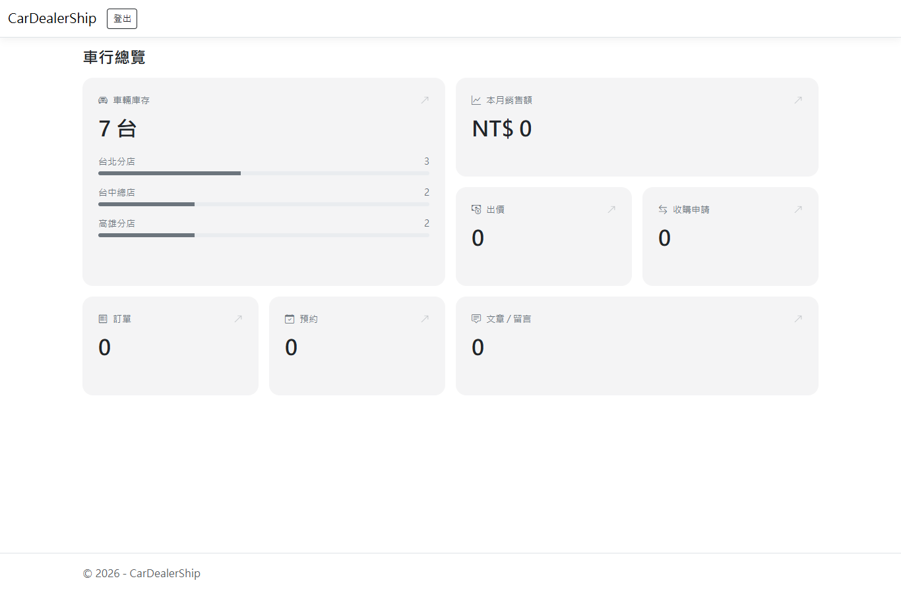

以 ASP.NET Core MVC 開發的二手車行後台管理系統，提供車行老闆管理車輛、車輛圖片、分店與社群貼文。

> 目前完成後台管理功能，訂單、出價、預約賞車、二手車估價等功能開發中。

> 截圖中的分店、車輛與車輛圖片皆為示範資料，圖片為AI產生的示意圖。

## 使用技術

後端 | ASP.NET Core MVC（.NET 10）、C# |
資料存取 | Entity Framework Core 10（Code First、Migrations） |
資料庫 | SQL Server（開發環境使用 LocalDB） |
驗證 | Cookie Authentication、角色授權、BCrypt
前端 | Razor Views、Bootstrap 5、jQuery Validation
